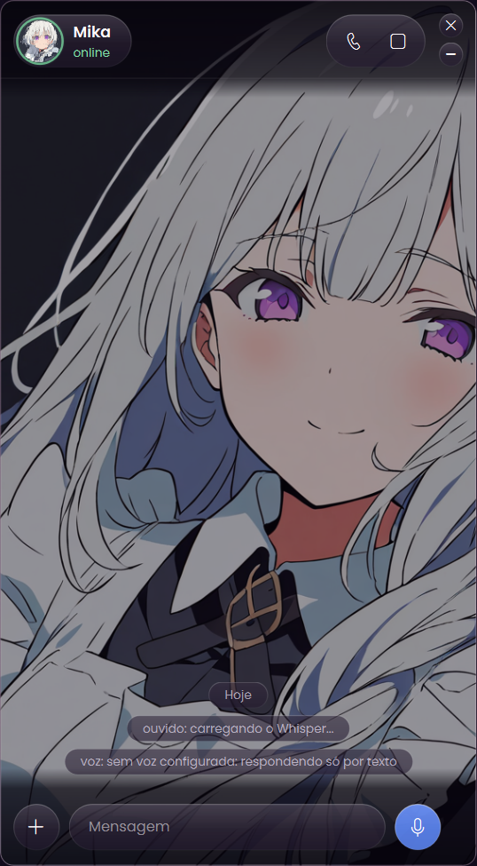

<p align="center">
  
</p>

<h1 align="center">Maid Me</h1>
<p align="center">Monte a sua própria assistente de voz para Windows e Linux: com nome, personalidade e voz escolhidos por você.<br>
<i>Maid de empregada, "made me" de "me fez". Sim, o nome é um trocadilho. Não, não vamos mudar.</i></p>

---

<p align="center"></p>


Você chama pelo nome ("Ei, Mika, abre o YouTube"), ela responde falando e mexe no seu PC: abre programas, procura arquivos, pesquisa na internet. Opcionalmente ela ganha um corpo de VTuber pelo VTube Studio e passa a fazer careta pra você também.

É tipo ter uma Alexa, só que com personalidade, sem ficar te oferecendo produto e que obedece de verdade. Na maioria das vezes.

## Recursos

- **Qualquer IA**: Google Gemini (tem uso grátis), Claude (assinatura ou API), ChatGPT, OpenRouter, Groq, DeepSeek, Ollama (local) ou qualquer API compatível com a OpenAI. Cada pessoa usa a própria chave.
- **Voz**: Microsoft Edge (grátis, sem cadastro), Fish Audio ou ElevenLabs.
- **Reconhecimento de fala no próprio PC** com Whisper (GPU NVIDIA se tiver, processador se não tiver).
- **Personalidades prontas** (sarcástica, fofa, tsundere, mordomo...) ou escritas por você.
- **Segurança**: comandos perigosos (formatar disco, apagar pastas do sistema, desligar o PC...) só rodam depois de você dizer "sim". Ela é atrevida, não maluca.
- **Avatar** no VTube Studio, com boca sincronizada e expressões, e modo flutuante na tela.
- **Janela própria** com cara de app de mensagem: foto, fundo personalizado (a cor do tema se adapta à imagem), chamada por voz e histórico.
- **Memória**: lembra do que vocês conversaram nos últimos dias e retoma o assunto.
- **Modo netrunner**: um holograma estilo cyberpunk aparece no canto da tela enquanto ela fala, e ela "assina" as janelas em que mexe com a marca dela (dá pra criar a sua no próprio app).
- **Assistindo junto**: comenta o que está na sua tela, usando um modelo de visão local pelo Ollama pra não gastar token.
- Configuração dentro do próprio app, com botões que abrem a página de cada chave. Nada de editar arquivo.

## Instalação

1. Baixe o `.zip` da página [Releases](../../releases) (ou o código pelo botão **Code → Download ZIP**) e extraia numa pasta fixa.
2. Dê dois cliques em **`Instalar Maid Me.bat`**.
3. Preencha a configuração que abre no final e clique em **Salvar e iniciar**.

### Linux

Extraia o zip e rode no terminal:

```bash
bash "Instalar Maid Me (Linux).sh"
```

Precisa de X11 (Wayland ainda não) e usa `xdotool`, `xprop` e `paplay`. O suporte é novo e ainda não foi testado em muitas distros, então relatos de bug são bem-vindos.

O passo a passo completo, incluindo onde pegar cada chave, está no [GUIA.html](GUIA.html).

**O que o instalador faz:** instala o Python oficial pelo winget se você não tiver, baixa as bibliotecas do PyPI para dentro de `app\.venv` e cria atalhos na área de trabalho e no menu Iniciar. Nada roda ao ligar o Windows. Para desinstalar, apague a pasta e os atalhos.

> O Windows pode avisar "O Windows protegeu o computador" porque os scripts não têm assinatura digital paga. Todo o código está aqui para você ler antes de rodar.

## Privacidade

- Chaves e configurações ficam só no seu computador, em `app\.env`.
- O áudio é transcrito localmente. Só o texto da conversa vai para o serviço de IA e de voz que você escolheu (e prints da tela, apenas se você ligar o recurso de comentar vídeos).

## Requisitos

Windows 10 ou 11 ou Linux com X11, microfone e conexão com a internet. Placa NVIDIA é recomendada, mas não obrigatória.

## Créditos

- Fonte [Poppins](https://fonts.google.com/specimen/Poppins), licença SIL Open Font License (`app/assets/fonts/OFL.txt`).
- Ícones da fonte Segoe Fluent Icons, que já vem no Windows (não é redistribuída aqui).
- [faster-whisper](https://github.com/SYSTRAN/faster-whisper), [edge-tts](https://github.com/rany2/edge-tts), [PySide6](https://doc.qt.io/qtforpython-6/).

## Licença

[MIT](LICENSE.txt)
